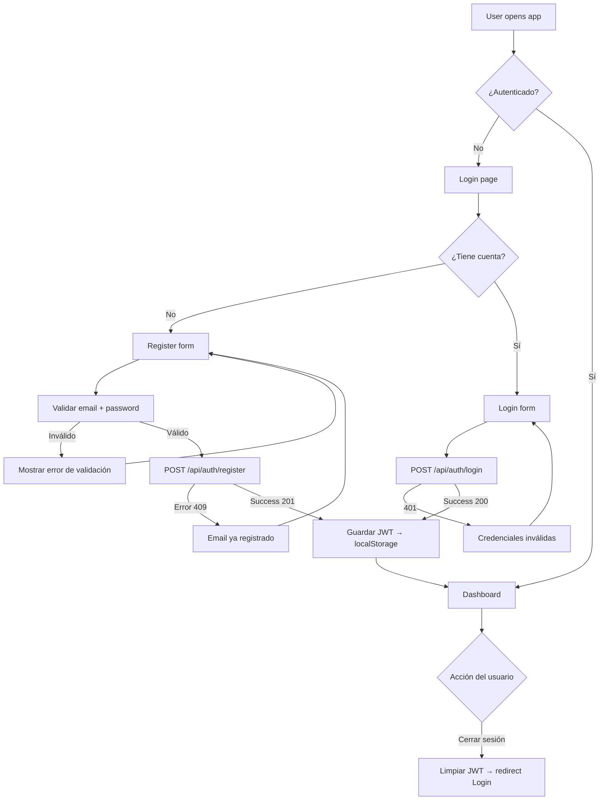
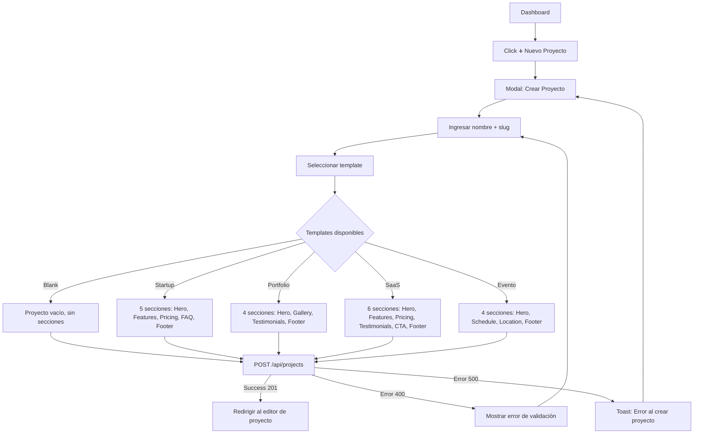
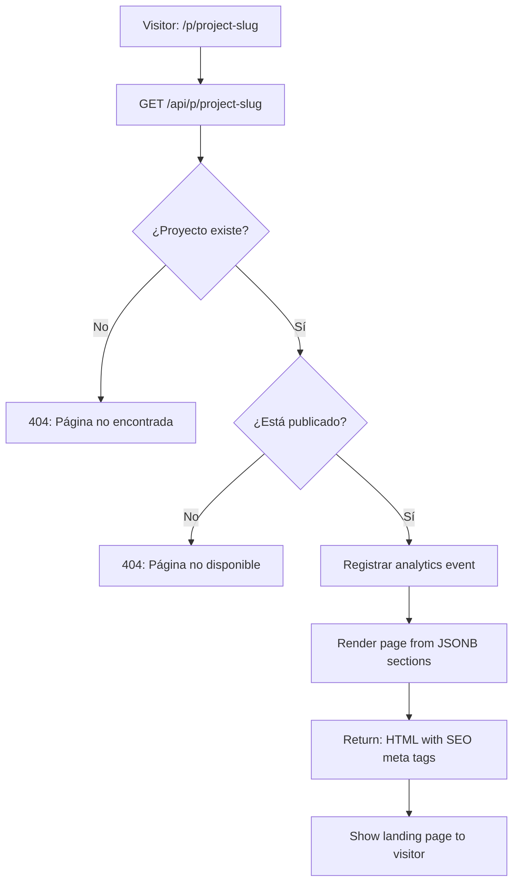

# Flow Diagrams — Hermes Landing Builder

> User flows for authentication, project management, section editing, publishing, and analytics.

---

## 1. Authentication Flow



### Paso a paso

1. **Usuario no autenticado** → ve login page
2. **Registro**: Completa formulario → validación cliente → `POST /api/auth/register` → JWT → guarda token → redirige a dashboard
3. **Login**: Completa formulario → `POST /api/auth/login` → JWT → guarda token → redirige a dashboard
4. **Logout**: Limpia localStorage → redirige a login
5. **Protección**: AuthGuard verifica JWT en cada ruta protegida; expiración 7 días
6. **Error states**: 401 → redirige a login, 409 → "Email ya registrado", otros errores → toast de error

---

## 2. Project Creation Flow



### Paso a paso

1. Usuario en dashboard → click "Nuevo Proyecto"
2. Modal con formulario: nombre (requerido), slug (auto-generado desde nombre, editable), template selector
3. Template selector muestra 5 opciones con preview cards: Blank, Startup, Portfolio, SaaS, Evento
4. Loading state mientras se crea: botón "Creando..." con spinner
5. Error: 400 validation → mostrar errores inline; 500 → toast "Error al crear proyecto"
6. Success: redirigir a `/editor/:projectId` donde el editor carga el proyecto + secciones del template

---

## 3. Section Editor Flow

```mermaid
graph TD
  A[Editor: Project loaded] --> B{Cargar secciones}
  B -->|Loading| C[Skeleton preview]
  B -->|Empty| D[Preview: "Añade tu primera sección"]
  B -->|Success| E[Render secciones en preview]

  E --> F[Sidebar: lista de secciones]
  D --> F

  F --> G{Acción del usuario}

  G -->|Añadir sección| H[Click tipo de sección en sidebar]
  H --> I[POST /api/sections → nueva sección]
  I --> J[Sección agregada al final + animación slide-up]
  J --> E

  G -->|Seleccionar sección| K[Click en sección de sidebar]
  K --> L[Abrir panel de edición de sección]
  L --> M[Editar campos de texto, colores, estilos]
  M --> N[Auto-save: PUT /api/sections/:id]
  N --> O[Toast "Guardando..." → "Guardado"]
  O --> E

  G -->|Reordenar| P[Drag & drop en sidebar]
  P --> Q[Optimistic UI: reordenar preview inmediatamente]
  Q --> R[POST /api/sections/reorder]
  R -->|Success| S[Confirmar orden]
  R -->|Error| T[Deshacer reordenación + toast error]
  S --> E

  G -->|Eliminar sección| U[Click 🗑️ en sección]
  U --> V[Confirmar: "¿Eliminar sección?"]
  V -->|Sí| W[DELETE /api/sections/:id]
  W --> X[Sección removida con animación]
  X --> E
  V -->|No| E

  G -->|Alternar vista| Y[Click 📱 Mobile / 🐾 Desktop]
  Y --> Z[Preview cambia de ancho (375px ↔ 100%)]
```

### Paso a paso

1. **Carga inicial**: Al abrir el editor, GET `/api/projects/:id/sections` → lista de secciones ordenadas
2. **Añadir**: En sidebar hay botones por tipo de sección. Click → POST → nueva sección al final → animación slide-up en preview
3. **Seleccionar**: Click en sidebar → panel derecho de edición con campos específicos del tipo de sección
4. **Editar contenido**: Textos editables con auto-guardado debounced (1s después del último cambio)
5. **Editar estilos**: Color pickers para fondo/texto/acento → cambio inmediato en preview
6. **Reordenar**: Drag & drop HTML5 → optimistic reorder → API call → on error revert + toast
7. **Eliminar**: Click delete → confirm dialog → API delete → animación fade-out + remover del DOM
8. **Vista responsiva**: Toggle desktop/mobile → preview se re-renderiza con breakpoint correspondiente

---

## 4. Publish / Unpublish Flow

```mermaid
graph TD
  A[Editor: project loaded] --> B{Estado del proyecto}

  B -->|Draft| C[Botón Publicar visible]
  B -->|Published| D[Botón Despublicar visible]

  C --> E[Click Publicar]
  E --> F[Confirmación: "¿Publicar esta página?"]
  F --> G{Confirmado?}
  G -->|Sí| H[PATCH /api/projects/:id/publish]
  G -->|No| A

  H -->|Success| I[Estado → published]
  I --> J[Toast: "✅ ¡Página publicada!"]
  J --> K[URL pública: /p/project-slug]
  K --> L[Botón "Ver página" aparece en editor]

  H -->|Error| M[Toast: "Error al publicar"]
  M --> A

  D --> N[Click Despublicar]
  N --> O[Confirmación: "¿Despublicar? La URL dejará de funcionar"]
  O --> P{Confirmado?}
  P -->|Sí| Q[PATCH /api/projects/:id/unpublish]
  P -->|No| A

  Q -->|Success| R[Estado → draft]
  R --> S[Toast: "📝 Página despublicada"]
  S --> A

  Q -->|Error| T[Toast: "Error al despublicar"]
  T --> A
```

### Paso a paso

1. **Estado draft**: Editor muestra botón "🌐 Publicar" en header
2. **Click Publicar**: Confirm dialog → PATCH publish → estado cambia a "published"
3. **Publicado**: Se genera URL pública `/p/[slug]`, botón "👁️ Ver página" aparece, badge cambia a "🌐 Published"
4. **Estado published**: Botón cambia a "📝 Despublicar"
5. **Click Despublicar**: Confirm dialog → PATCH unpublish → estado revierte a "draft"
6. **Transiciones válidas**: draft → published, published → draft
7. **Transiciones inválidas**: draft → draft (no-op), published → published (no-op)
8. **Error handling**: Cualquier error muestra toast con botón reintentar

---

## 5. Analytics Flow

```mermaid
graph TD
  A[Editor → Pestaña Analytics] --> B[GET /api/projects/:id/analytics]

  B -->|Loading| C[Skeleton: KPIs + chart placeholders]
  B -->|Empty| D["Publica tu página para ver analytics"]
  B -->|Success| E[Render analytics dashboard]

  E --> F[KPI: Total visits]
  E --> G[Chart: Visitas por día (últimos 7 días)]
  E --> H[Table: Últimas visitas]

  F --> I[Cifra con animación de conteo]
  G --> J[Barras SVG con tooltip por día]
  H --> K[Lista con fecha, hora, página]

  E --> L{Public page visitor}
  L --> M[GET /api/p/project-slug]
  M --> N[Registrar analytics event]
  N --> O[Incrementar contador + guardar evento con timestamp]
  O --> P[Render page HTML]
```

### Paso a paso

1. **Edición de analíticas**: Clic en pestaña "Analytics" en el editor
2. **Carga**: Skeleton con 3 KPIs y chart placeholder mientras GET /api/projects/:id/analytics
3. **No publicado**: Empty state con mensaje "Publica tu página para ver analytics"
4. **Publicado con datos**: KPIs (total visits, visits today, unique days), chart (daily bar chart), table (recent visits)
5. **Registro de visitas**: Cada visita a `/p/[slug]` → POST /api/analytics/events → incrementa contador + timestamp
6. **Datos agregados**: Backend usa `GROUP BY DATE(timestamp) ORDER BY timestamp` para chart
7. **Actualización**: Los analytics se refrescan cada 30 segundos o al recargar la página

---

## 6. Public Page Request Flow



### Paso a paso

1. Visitante navega a `/p/[slug]` en el navegador
2. Backend verifica: ¿proyecto existe? → ¿está published? → registra evento analytics → renderiza HTML
3. SEO meta tags (title, description, OG tags) se inyectan en el `<head>` del HTML renderizado
4. Las secciones se construyen desde el JSONB `componentData` de cada sección
5. **404 states**: `No encontrada` (proyecto no existe), `No disponible` (no publicado)
6. **Error**: 500 → página de error genérica con mensaje "Algo salió mal"
